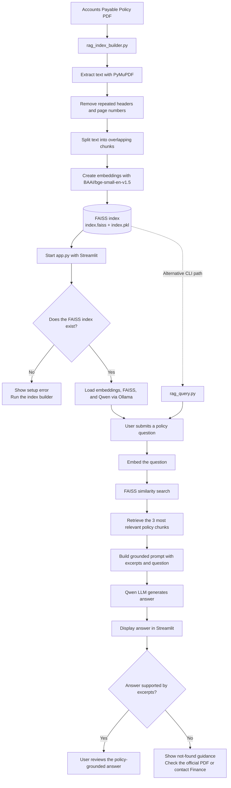

# AuditPilot

AuditPilot is a Streamlit application that answers questions about an Accounts Payable policy. It uses retrieval-augmented generation (RAG): the application retrieves the most relevant sections from a locally built FAISS index and sends only those excerpts to a local Ollama language model.

The application is designed to keep answers grounded in the policy document. Its prompt instructs the model to preserve policy names and reference numbers, avoid confusing section headings with policy names, avoid inventing unsupported information, and say that it does not know when the retrieved excerpts do not support an answer.

## Features

- Streamlit web interface for asking policy questions.
- Local FAISS vector search over the Accounts Payable policy.
- Hugging Face `BAAI/bge-small-en-v1.5` embeddings.
- Local Ollama model integration using `qwen2.5:7b`.
- Three-document similarity retrieval for each question.
- Clear status indicators for the policy index and Ollama model.
- Download button for the source policy PDF.
- User-friendly error, empty-state, and unsupported-answer messages.

## Main components

- **Embedding model (`BAAI/bge-small-en-v1.5`):** Converts policy chunks and questions into numerical vectors.
- **FAISS:** Searches those vectors to retrieve relevant policy chunks.
- **LLM (Qwen):** Reads the retrieved chunks and generates an answer based only on the policy context.

## Project structure

```text
policy assistant/
|-- app.py
|-- rag_index_builder.py
|-- rag_query.py
|-- requirements.txt
|-- README.md
|-- .env
|-- docs/
|   `-- Accounts_Payable_Policy.pdf
|-- rag_faiss_index/
|   |-- index.faiss
|   `-- index.pkl
`-- myenv/
```

## File and directory details

### `app.py`

This is the main Streamlit application.

Responsibilities:

- Configures the Streamlit page title and icon.
- Defines the locations of the FAISS index and source PDF.
- Applies the custom CSS used for layout, buttons, hover states, and keyboard focus.
- Renders the AuditPilot header, subtitle, explanatory text, information cards, footer, and sidebar.
- Checks whether the FAISS index exists before loading the application.
- Checks whether the configured Ollama model is installed and reachable.
- Loads the embedding model, FAISS database, and Ollama chat model through cached resources.
- Accepts a user question through a Streamlit form.
- Retrieves the three most similar policy documents from FAISS.
- Builds a grounded prompt containing the retrieved excerpts and the user question.
- Displays the generated answer and explains when the model could not find support in the policy.
- Provides a download button for `docs/Accounts_Payable_Policy.pdf`.

Important configuration values in this file:

```python
INDEX_DIR = "./rag_faiss_index"
MODEL_NAME = "qwen2.5:7b"
POLICY_PDF = "./docs/Accounts_Payable_Policy.pdf"
```

The app uses `allow_dangerous_deserialization=True` when loading the local FAISS index. This is required by the current LangChain FAISS loading flow, so only load index files that are trusted and generated for this project.

### `rag_index_builder.py`

This script creates or replaces the local FAISS index from the source policy PDF.

Processing flow:

1. Opens the PDF with PyMuPDF.
2. Extracts text from every page.
3. Removes the repeated `FIN-AP-001 | ACCOUNTS PAYABLE POLICY | v1.1 Page N` header and page-number text.
4. Splits the cleaned text into chunks of 1,200 characters with 150 characters of overlap.
5. Wraps the chunks in LangChain `Document` objects.
6. Creates embeddings using `BAAI/bge-small-en-v1.5`.
7. Builds a FAISS vector database.
8. Saves the database to `rag_faiss_index`.

Run it after changing the source PDF or changing the embedding model:

```powershell
python rag_index_builder.py
```

The script's default input and output paths are:

```text
Input:  ./docs/Accounts_Payable_Policy.pdf
Output: ./rag_faiss_index
```

The embedding model used here must remain the same as the model used by `app.py` and `rag_query.py`; otherwise, the stored vectors and query vectors will not be compatible.

### `rag_query.py`

This is a command-line example for querying the existing FAISS index without starting Streamlit.

It:

- Loads the same Hugging Face embedding model as the index builder.
- Loads the existing FAISS database.
- Creates a `ChatOllama` client using `qwen2.5:7b`.
- Runs a hard-coded example question.
- Retrieves the three most relevant policy passages.
- Prints a short preview of each passage.
- Sends the combined passages to the model using the same grounding rules as the web app.
- Prints the model's answer.

Run it with:

```powershell
python rag_query.py
```

To test another question, edit the `query` value in the file before running it.

### `requirements.txt`

This file lists the Python packages required by the project:

| Package | Purpose |
|---|---|
| `openai` | OpenAI client dependency retained for the project environment |
| `langchain` | LangChain framework |
| `autogen` | Agent framework dependency retained for the project environment |
| `pymupdf` | PDF text extraction; imported as `fitz` |
| `streamlit` | Web application interface |
| `langchain-core` | Core LangChain document and runnable types |
| `langchain-text-splitters` | Splits extracted policy text into chunks |
| `langchain-community` | Community integrations, including FAISS |
| `langchain-huggingface` | Hugging Face embedding integration |
| `sentence-transformers` | Local sentence embedding model support |
| `faiss-cpu` | Local vector similarity search |
| `langchain-ollama` | LangChain integration for Ollama chat models |
| `ollama` | Ollama Python client used by the model availability check |

Install the dependencies with:

```powershell
pip install -r requirements.txt
```

### `docs/Accounts_Payable_Policy.pdf`

This is the source policy document. It is used in two places:

- `rag_index_builder.py` extracts its text to build the searchable index.
- `app.py` makes it available for download so users can verify generated answers against the official document.

If this file is replaced, rebuild the FAISS index before starting the app.

### `rag_faiss_index/index.faiss`

This is the FAISS binary index containing the vector representations of the policy chunks. It is generated by `rag_index_builder.py` and loaded by `app.py` and `rag_query.py`.

### `rag_faiss_index/index.pkl`

This file stores the serialized LangChain document metadata associated with the FAISS vectors. It must remain alongside `index.faiss` for the vector store to load correctly.

Do not manually edit either generated index file. Recreate them by running the index builder.

### `.env`

The project includes an empty `.env` file as a place for local environment configuration. The current application does not read environment variables directly from this file, and no secrets should be committed to source control.

If environment variables are added later, document their names and purpose without adding secret values to the repository.

### `myenv/`

This is the local Python virtual environment containing installed packages and interpreter support for this workspace. It is a development/runtime artifact, not application source code.

It should generally not be copied into deployments or committed to version control. A fresh environment can be created and populated from `requirements.txt` instead.

## Setup

### 1. Create and activate a virtual environment

From PowerShell:

```powershell
python -m venv .venv
.\.venv\Scripts\Activate.ps1
```

If PowerShell blocks activation, use the Python executable directly or adjust the local execution-policy setting according to your organization's policy.

### 2. Install Python dependencies

```powershell
python -m pip install --upgrade pip
pip install -r requirements.txt
```

### 3. Install and prepare Ollama

Install Ollama separately from Python, start the Ollama service, and download the model configured by the application:

```powershell
ollama pull qwen2.5:7b
```

The application expects Ollama to be available locally and uses a deterministic temperature of `0`.

### 4. Build the policy index

Build the index if `rag_faiss_index/index.faiss` and `rag_faiss_index/index.pkl` do not exist, or whenever the source PDF changes:

```powershell
python rag_index_builder.py
```

### 5. Start AuditPilot

```powershell
streamlit run app.py
```

Streamlit will print a local URL to open in a browser.

## End-to-end workflow

The workflow has two phases: an indexing phase that prepares the searchable policy database, and a question-answering phase that uses the saved database.



### Workflow summary

1. **Prepare the index:** `rag_index_builder.py` reads the policy PDF, cleans repeated page text, splits the content into overlapping chunks, embeds each chunk, and saves the FAISS index.
2. **Start the application:** `app.py` checks that the index exists, loads the index and embedding model, and connects to the Qwen model through Ollama.
3. **Ask a question:** The user submits a question in the Streamlit interface. `rag_query.py` provides an alternative command-line query path.
4. **Retrieve evidence:** The question is converted into a vector, and FAISS returns the three most relevant policy chunks.
5. **Generate a grounded answer:** The retrieved chunks and the question are sent to Qwen with instructions to use only the supplied policy context and avoid unsupported claims.
6. **Review the result:** The answer is displayed in the UI. If the excerpts do not support an answer, the app tells the user to rephrase the question or verify the official policy.

The source PDF remains the authority for important decisions. Users can download it from the application to verify an answer.

## Troubleshooting

### Policy index not found

Run:

```powershell
python rag_index_builder.py
```

Then reload the Streamlit page.

### Ollama model is not installed

Run:

```powershell
ollama pull qwen2.5:7b
```

Confirm that Ollama is running before starting or refreshing the app.

### PDF changes are not reflected

Rebuild the index after changing the PDF:

```powershell
python rag_index_builder.py
```

### Embedding or FAISS loading errors

Make sure the same embedding model, `BAAI/bge-small-en-v1.5`, is used when building and loading the index. If the index is corrupted or was created with another embedding model, delete only the generated files inside `rag_faiss_index` and rebuild the index.

## Notes on answer quality

AuditPilot is retrieval-based, so its answers depend on the quality and coverage of the retrieved excerpts. The application intentionally tells the model not to invent policy details. Important business decisions should still be checked against the official PDF and escalated to the Finance team when the policy does not provide a clear answer.
